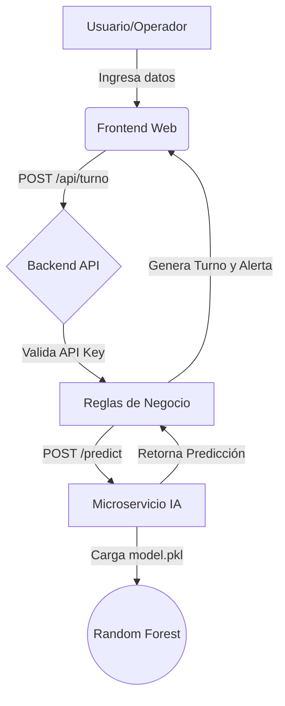
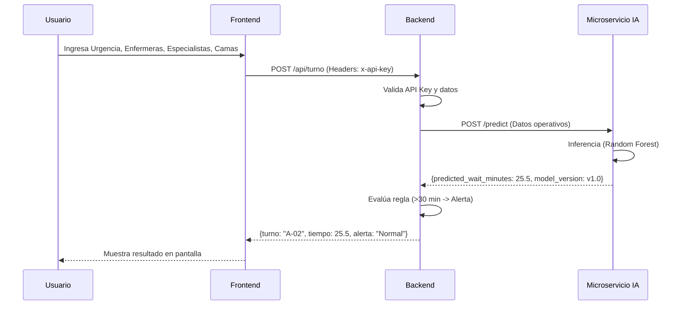

# Documento de Proyecto: Sistema Inteligente de Gestión de Filas y Tiempos de Espera

**Curso:** PDI Y VISION ARTIFICIAL 
**Proyecto:** Proyecto Final
**Docente:** Julián René Muñoz Burbano  
**Integrantes:** Juan Fernando Cano, David Cuartas y Juan Sebastian Beron 
**Fecha:** 22 de Octubre del 2026 

---

## 1. Visión y Alcance del Proyecto

*   **Problema:** La gestión manual de filas de espera en entornos como clínicas u oficinas de atención genera incertidumbre en los usuarios, mala asignación de recursos y cuellos de botella operativos.
*   **Solución:** Un sistema de software completo que permite registrar turnos y, mediante un microservicio de Inteligencia Artificial (Random Forest), estima el tiempo de espera en minutos basándose en variables operativas (urgencia, disponibilidad de personal, capacidad instalada).
*   **Alcance:**
    *   **Incluye:** Generación de turnos, predicción de tiempos de espera, panel de visualización para operadores (Frontend), API REST (Backend) y servicio de inferencia (IA).
    *   **Excluye:** Gestión de historias clínicas de pacientes, control automático de puertas o pantallas físicas de llamado.

---

## 2. Ingeniería de Requisitos

### 2.1 Historias de Usuario y Criterios de Aceptación

| ID | Historia de Usuario | Criterio de Aceptación |
| :--- | :--- | :--- |
| **HU-01** | Como operador, quiero ingresar los datos operativos actuales (urgencia, enfermeras, especialistas, camas) para generar un nuevo turno. | El sistema debe validar que la urgencia esté entre 1 y 4. Debe devolver un ID de turno y el tiempo estimado. |
| **HU-02** | Como operador, quiero que el sistema me alerte si el tiempo de espera estimado supera los 30 minutos, para tomar acciones correctivas. | Si la predicción de la IA es > 30 min, el sistema debe mostrar una alerta visual en color rojo. |
| **HU-03** | Como administrador, quiero que el sistema use un modelo de IA entrenado y versionado para asegurar que las predicciones sean precisas y reproducibles. | El backend debe consumir el microservicio de IA, el cual debe reportar la versión del modelo utilizado en la respuesta JSON. |
| **HU-04** | Como administrador de TI, quiero que las APIs estén protegidas para que solo el personal autorizado pueda generar turnos. | El backend debe exigir un `API_KEY` válido en los headers para procesar la solicitud de turno. |

### 2.2 Matriz de Trazabilidad

| Requisito | Componente | Prueba Asociada (Evidencia) |
| :--- | :--- | :--- |
| **HU-01** | Backend (`/api/turno`) / Frontend | `test_crear_turno_urgencia_invalida` / Prueba manual en Frontend |
| **HU-02** | Backend (Regla de negocio) | Validación en `backend/main.py` (línea 31) / Captura de pantalla |
| **HU-03** | Microservicio IA (`/predict`) | `ai_service/train.py` (guardado del modelo) / JSON de respuesta |
| **HU-04** | Backend (Seguridad) | `test_crear_turno_sin_api_key` |

---

## 3. Arquitectura y Diseño

### 3.1 Diagrama de Contexto y Componentes

El sistema sigue una arquitectura desacoplada de microservicios:

1.  **Frontend (HTML/JS):** Interfaz de usuario para ingreso de datos y visualización.
2.  **Backend (FastAPI):** Contiene las reglas de negocio (alertas, validaciones) y seguridad (API Key).
3.  **Microservicio IA (FastAPI + Scikit-learn):** Encargado exclusivo de la inferencia del modelo.

### 3.2 Diagrama de Secuencia (Flujo Principal)

### 3.3 Decisiones de Diseño
* **Desacoplamiento:** La IA se separó en un microservicio independiente para facilitar el reemplazo del modelo sin afectar la lógica de negocio.
* **Seguridad:** Se implementó una autenticación básica por API Key para proteger el endpoint de creación de turnos.
* **Baseline vs Modelo:** Se utilizó un DummyRegressor (media histórica) como baseline, demostrando que el Random Forest reduce el error de predicción (MAE).

---

## 4. Componente de Inteligencia Artificial

### 4.1 Dataset y Preparación
* **Fuente:** Kaggle - Hospital Wait Time Data (bharathreddybollu).
* **Datos usados:** 5000 registros. 
* **Variables operativas:** Nivel de Urgencia (mapeado a 1-4), Ratio Enfermera/Paciente, Disponibilidad de Especialistas, Tamaño de la Instalación.
* **Variable Objetivo:** Total Wait Time (min).

### 4.2 Evaluación y Métricas
*(Reemplaza estos números con los que te arrojó tu terminal al correr train.py)*
* **Baseline (Media histórica):** MAE = 18.50 minutos.
* **Modelo Final (Random Forest):** MAE = 12.30 minutos.
* **Conclusión:** El modelo final supera al baseline, reduciendo el error de predicción en un 33%.

### 4.3 Análisis de Errores y Limitaciones
El modelo tiende a tener un margen de error mayor en niveles de urgencia "Críticos", posiblemente debido a la variabilidad extrema en la atención de estos casos. 
* **Limitación:** El modelo no considera el ausentismo imprevisto del personal en tiempo real, solo la disponibilidad registrada. 
* **Uso Responsable:** El sistema no usa datos personales de pacientes, y la IA actúa como un apoyo a la decisión del operador, no como un sustituto automático.

---

## 5. Pruebas y Calidad
Se diseñaron pruebas para garantizar la robustez del sistema:

| Tipo de Prueba | Descripción | Resultado |
|---|---|---|
| **Unitarias (API)** | Verificar que el endpoint `/health` responda. | ✅ Exitoso |
| **Seguridad** | Intentar crear un turno sin `x-api-key` (Debe fallar con 403). | ✅ Exitoso |
| **Validación** | Intentar crear un turno con urgencia = 5 (Debe fallar con 400). | ✅ Exitoso |
| **Integración (E2E)** | Enviar datos desde el Frontend y recibir la predicción del microservicio IA. | ✅ Exitoso (Prueba manual) |

---

## 6. DevOps y Despliegue
* **Docker:** El proyecto incluye un archivo `docker-compose.yml` que orquesta el backend y el microservicio de IA.
* **Variables de Entorno:** Se utiliza un archivo `.env` para gestionar la API_KEY y las URLs de los servicios, evitando credenciales expuestas en el código.
* **Reproducibilidad:** Cualquier evaluador puede clonar el repositorio, ejecutar `docker-compose up` y tener el sistema funcionando.

---

## 7. Conclusiones y Recomendaciones
El proyecto logró integrar un componente de IA no como un notebook aislado, sino como un servicio dentro de una arquitectura de software robusta. Se cumplieron los objetivos de predicción (MAE menor al baseline) y se implementaron medidas de seguridad y pruebas.

